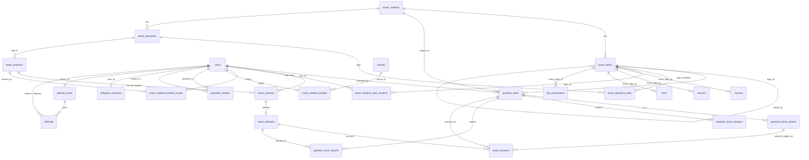
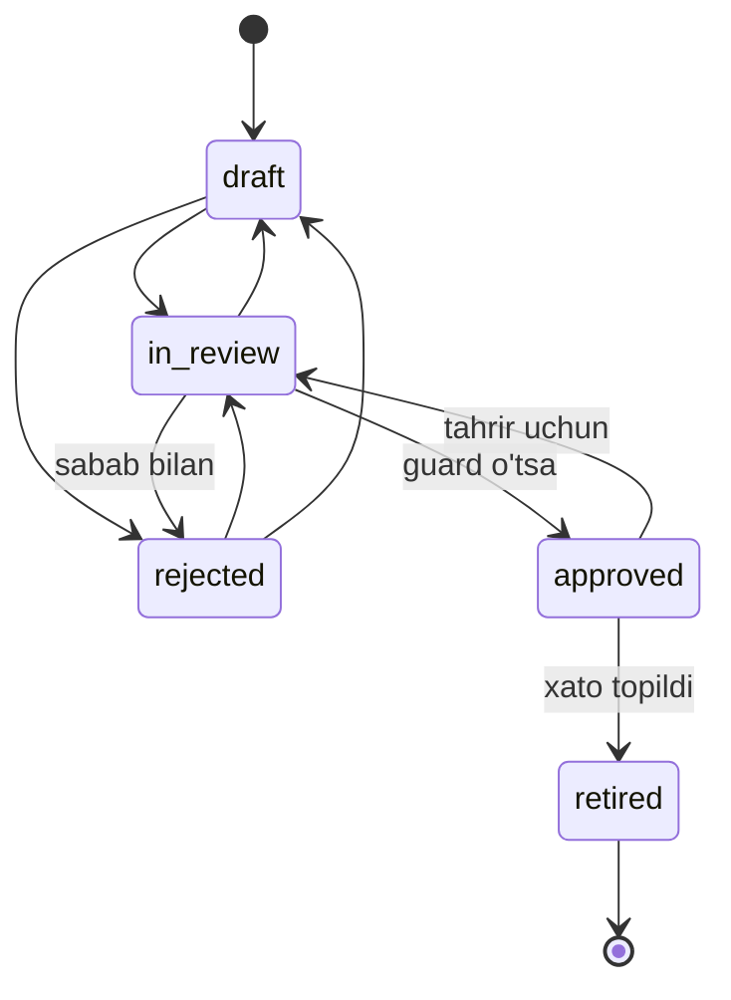

# Bosqich 2 — Ma'lumotlar modeli (Exam moduli)

**Branch:** `wip/examdb` (asosi `feature/shanba-imtihoni`)
**Doira:** prompt'ning 4-bo'limi (Bosqich 2) hamda 4a.1 va 4a.3 ning ma'lumotlar qismi. UI, variant generatori, baholash va bot keyingi bosqichlarda.
**Asos:** `docs/exam/00_ANALYSIS.md` §3 (arxitektura) va §5a (egasining qarorlari).

---

## 1. Konvensiyalar

| Qoida | Qanday bajarildi |
|---|---|
| Joylashuv | `App\Models\Exam\*`, `App\Enums\Exam\*`, `App\Services\Exam\*`, `App\Support\Exam\*`, `App\Exceptions\Exam\*`, `database/factories/Exam/*`, `database/seeders/Exam/*` |
| Jadval nomi | Imtihonga xos jadvallar `exam_` prefiksi bilan. Platforma bo'ylab ishlatiladiganlar prefikssiz: `guardian_student`, `telegram_accounts`, `referral_codes`, `referrals`. `question_bank` atrofidagilar uning nomini davom ettiradi: `question_bank_options`, `question_bank_answers`, `question_error_reports` |
| Kalit | Hamma joyda UUID (`HasUuids`), FK'lar `foreignUuid` |
| Soft delete | Uzoq yashaydigan, qo'lda boshqariladigan yozuvlar: `exam_subjects`, `exam_topics`, `exam_blueprints`, `exam_sessions` (`question_bank` da avvaldan bor). Natija va urinishlarda yo'q — ular o'chirilmaydi, holat bilan boshqariladi |
| Holat maydonlari | `string` ustun + PHP backed enum cast (`ReviewStatus`, `QuestionOrigin`, `ExamSessionStatus`, ...). Mavjud `question_bank.status` ham shunday. Sabab: yangi holat qo'shish MySQL'da `ALTER TABLE ... ENUM` talab qilmaydi; qiymatlar to'plami PHP'da bitta joyda |
| Migratsiyalar | Faqat qo'shuvchi. Yagona istisno — `section_type`/`correct_answer` ni nullable qilish (alohida migratsiya, egasi tasdiqlagan, Q-4) |
| Mavjud modellar | Minimal tegish: `QuestionBank` ga bitta `use ExamQuestion;`, `User` ga bitta `use HasExamRelations;` (alohida kichik commit'lar). Butun mantiq yangi trait'larda |

---

## 2. ER sxema (umumiy ko'rinish)



Savol holatlari:



---

## 3. Jadvallar

### 3.1. Fanlar va mavzular

**`exam_subjects`** — `code` (unique: `math`, `physics`), `name_uz`, `name_ru`, `direction_id` (LMS yo'nalishiga ixtiyoriy bog'lanish), `sort_order`, `is_active`, soft delete.

**`exam_topics`** — daraxt: fan → bo'lim (`level = 1`) → mavzu (`level = 2`, chuqurroq ham mumkin).
- `subject_id`, `parent_id` (o'ziga FK, `restrict`), `code` (global unique, masalan `math.equations.quadratic`), `name_uz`, `name_ru`, `description`, `level`, `grade_from`/`grade_to` (sinf oralig'i), `sort_order`, `is_active`, soft delete.
- Indekslar: `(subject_id, parent_id, sort_order)`, `(subject_id, level)`.
- Model qoidalari (`Topic::saving`): `level` va `subject_id` ota-onadan olinadi; boshqa fanning ota-onasi va o'z avlodi ostiga ko'chirish (sikl) taqiqlanadi.
- `descendantAndSelfIds()` — bo'lim bo'yicha savol tanlash uchun (har daraja uchun bitta so'rov; daraxt 2–3 daraja).

### 3.2. Savollar banki

**`question_bank` (kengaytirildi, olimpiada ustunlari tegilmagan)**

| Ustun | Izoh |
|---|---|
| `subject_id` FK, `topic_id` FK → `exam_topics` | `topic_id` avval FK'siz edi; undagi qiymatlar hech qayerga ishora qilmagani uchun FK qo'shishdan oldin NULL qilinadi |
| `difficulty_level` 1–5 | Eski `difficulty` dan to'ldirildi: easy→2, medium→3, hard→4, expert→5 |
| `exam_formats` JSON | `milliy_sertifikat`, `abituriyent`, `sat` |
| `source_ref` | qo'llanma/to'plam, bet, masala raqami |
| `origin` | `ai_draft` / `manual` / `import` (default `manual`) |
| `review_status` | `draft` / `in_review` / `approved` / `rejected` / `retired` (default **`draft`** — yangi qator hech qachon o'z-o'zidan tasdiqlanmaydi) |
| `reviewed_by`, `reviewed_at`, `reject_reason` | tekshiruv izi |
| `solution_video_url`, `solution_text` | yechim (LaTeX-markdown) |
| `content_format` | default `latex_markdown` |
| `units_note`, `constants` JSON | fizika: `{"g": {"value": 10, "unit": "m/s²"}}` |
| `error_reports_count` | `QuestionErrorReport` yaratilganda/o'chirilganda avtomatik |
| `is_demo` | seed qilingan namunalar |
| `normalized_hash` | normalizatsiya qilingan shartning sha1 — import va AI'da dublikat aniqlash (`App\Support\Exam\QuestionText`) |

Indekslar: `qb_exam_selection_idx (subject_id, topic_id, difficulty_level, review_status)`, `qb_review_queue_idx (review_status, created_at)`, `normalized_hash`, `is_demo`.

Alohida migratsiya: `section_type` va `correct_answer` **nullable** (egasi tasdiqlagan, Q-4). MySQL'da ustun joyida o'zgaradi; SQLite'da Laravel jadvalni qayta quradi.

**`question_bank_options`** — yopiq savol variantlari.
- `question_id`, `label` (A–E, `(question_id, label)` unique), `text` (LaTeX), `image`, **`is_correct` NULL default** (ustoz belgilamaguncha), `ai_suggested_correct` (ixtiyoriy yashirin AI maslahati, config flag bilan, default o'chiq), `sort_order`.

**`question_bank_answers`** — ochiq savollar javobi (`numeric`, `numeric_with_unit`; keyin `expression`). Batafsil — 5-bo'lim.

**`question_error_reports`** — «Savolda xato bor»: `question_id`, `user_id`, `attempt_id`, `message`, `status` (`open`/`accepted`/`dismissed`), `resolved_by`, `resolved_at`, `resolution_note`.

### 3.3. Blueprint, sessiya, variant, urinish

**`exam_blueprints`** — `subject_id`, `name`, `purpose` (`placement`/`weekly`/`open_regional`), `format`, `duration_min`, `total_questions` (= qoidalar `count` yig'indisi, `isConsistent()`), `wrong_unit_ratio` (birlik xato bo'lsa ball ulushi: 0 = 0 ball, 0,5 = yarim ball — prompt 4a.3 dagi «blueprint sozlamasi»), `avoid_repeat_weeks` (oxirgi N haftada ko'rilgan savollarni takrorlamaslik), `allow_adjacent_difficulty` (bank yetmasa qo'shni qiyinlik), `shuffle_questions`, `shuffle_options`, `is_active`, `created_by`, soft delete.

**`exam_blueprint_rules`** — `blueprint_id`, `topic_id`, `difficulty_level` (NULL = istalgan), `part` (`closed` — variantli / `open` — yozma javob; Milliy sertifikatning ikki qismi), `count`, `points_per_question`, `sort_order`.
- Qoida bo'limga ishora qilsa, bo'limning **butun daraxtidagi** savollar mos keladi.
- `closed` qism: `single_choice`, `multiple_choice`, `true_false`; `open` qism: `numeric`, `numeric_with_unit`.

**`exam_sessions`** — `subject_id`, `blueprint_id`, `type`, `title`, `starts_at`, `ends_at`, `registration_closes_at` (qabul testi uchun hammasi NULL — ochiq oyna), `duration_min` (blueprint'ni bekor qiladi), `status` (`draft → scheduled → open → closed → graded`, yoki `cancelled`), `variants_generated_at`, `results_published_at`, `created_by`, soft delete.

**`exam_variants`** — `session_id`, `user_id` (**`(session_id, user_id)` unique**), `seed`, `question_ids` JSON (tartib bilan), `option_orders` JSON (`{question_id: [option_id, ...]}`), `rule_map` JSON (`{question_id: rule_id}`), `used_fallback`, `generated_at`.

**`exam_attempts`** — olimpiada naqshi: `session_id`, `variant_id`, `user_id` (`(session_id, user_id)` unique), `session_token` (unique, `$hidden`), `status` (`in_progress`/`submitted`/`auto_submitted`/`graded`/`invalidated`), `started_at`, `expires_at` (server muddati), `submitted_at`, `graded_at`, `regraded_at`, `time_spent_seconds`, `last_heartbeat_at`, `score`, `max_score`, `score_percent`, `correct/wrong/skipped_count`, `device_fingerprint`, `ip_address`, `user_agent`, `violations_count`, `invalidated_reason`.
- Indeks `(status, expires_at)` — server tomonidagi auto-submit uchun (`ExamAttempt::expired()` scope).

**`exam_answers`** — `attempt_id`, `question_id` (`(attempt_id, question_id)` unique), `position`, `selected_option_id` / `selected_option_ids` JSON, `answer_text` (o'quvchi yozgani: `0,5`, `1/2`), `numeric_value`, `unit`, `is_correct` (NULL = javobsiz/baholanmagan), `unit_correct`, `points`, `max_points`, `is_flagged`, `time_spent_seconds`, `answered_at`. Indeks `(question_id, is_correct)` — savol statistikasi va regrade uchun.

### 3.4. O'quvchi natijalari va profili

**`exam_student_topic_mastery`** — `user_id`, `topic_id`, `subject_id`, `score` (0–100, model tekshiradi), `attempts_count`, `answered_count`, `correct_count`, `source`, `last_attempt_at`; `(user_id, topic_id)` unique.

**`exam_student_weekly_results`** — `user_id`, `session_id` (`(user_id, session_id)` unique), `attempt_id`, `subject_id`, `week_start`, `score`, `max_score`, `score_percent`, `delta_prev` (oldingi natijaga nisbatan foiz punkt), `rank`, `percentile`, `participants_count`. Indekslar reyting va «eng ko'p o'sganlar» uchun.

**`exam_student_profiles`** — `user_id` (unique), `grade` (5–11), `is_graduate`, `subjects` JSON (`["math","physics"]`), `goal` (`otm_grant`/`milliy_sertifikat`/`sat`/`school`), `region_id`, `district_id`, `school_id` (mavjud `regions/districts/schools` ga FK), `school_name` (maktablar ro'yxati hali yo'q), `show_name_publicly` (ommaviy reytingda ism faqat rozilik bilan), `public_alias`, `placement_completed_at`.

### 3.5. Ota-ona, Telegram, tavsiya

- **`users.role`** ga `guardian` qo'shildi (alohida, himoyalangan migratsiya, 4.4-bo'lim).
- **`guardian_student`** — `guardian_id`, `student_id` (`(guardian_id, student_id)` unique), `relation` (`mother`/`father`/`guardian`/`other`), **`consent_at`**, `consent_source`, `receives_reports`, `verified_at`. Model: `GuardianStudent` (Pivot, UUID). `User::wards()` / `User::guardians()`.
- **`telegram_accounts`** — `user_id` (nullable unique — bot foydalanuvchisi ro'yxatdan o'tguncha NULL), `telegram_id` (unique), `chat_id`, `username`, `first_name`, `last_name`, `language_code`, `is_blocked`, `start_payload`, `linked_at`, `last_interaction_at`.
- **`referral_codes`** — `owner_id` (unique), `code` (unique, 8 belgi, 0/O/1/I/L siz), `uses_count`, `is_active`. `startPayload()` → `ref_<code>`.
- **`referrals`** — `referral_code_id`, `referrer_id`, `referred_id` (unique — bir kishi bir marta taklif qilinadi), `status` (`joined → placement_done → subscribed`, orqaga qaytmaydi), har bosqich vaqti, `reward_granted_at`.

### 3.6. LMS bog'lanishi (4a.1)

`courses`, `lessons`, `tests`, `lab_experiments` ga nullable `exam_topic_id` FK (`ON DELETE SET NULL`), `courses.course_track` (`abituriyent`/`milliy_sertifikat`/`sat_math`/`school`, `App\Enums\Exam\CourseTrack`). Teskari aloqalar `Topic::courses()/lessons()/tests()/labExperiments()` da. Mavjud `Course/Lesson/Test/LabExperiment` modellariga tegilmadi (fillable va `examTopic()` UI quriladigan bosqichda qo'shiladi).

---

## 4. Qarorlar va asoslar

### 4.1. `question_bank` kengaytiriladi, yangi jadval ochilmaydi
Olimpiada, imtihon, battle va lab bitta bankdan foydalanadi (00_ANALYSIS §3.2). Olimpiada ustunlari tegilmagan. `QuestionReviewService::approve()` eski `options`/`correct_answer` JSON'larini sinxronlaydi (`status = active`, `is_verified = true`), shuning uchun `QuestionBank::checkAnswer()` va olimpiada kodi tasdiqlangan exam savollari bilan ham ishlaydi (test bilan tasdiqlangan).

### 4.2. Variantlar — alohida jadval
«Ustoz belgilamaguncha `is_correct` NULL» qoidasini, variant rasmini, indeks va auditni JSON ichida ta'minlash qiyin. Relation nomi `answerOptions()` — `options` nomi eski JSON atribut bilan to'qnashadi.

### 4.3. «AI to'g'ri javobni belgilamaydi» — qanday kafolatlanadi
1. `question_bank_options.is_correct` va `question_bank_answers.value` default NULL.
2. `QuestionApprovalGuard` — tasdiqlash shartlari:
   - fan, mavzu (shu fanga tegishli), qiyinlik 1–5, shart bo'sh emas, tur qo'llab-quvvatlanadi;
   - `single_choice` / `true_false`: 2–5 (true_false: 2) variant, **aynan bitta** `is_correct = true`;
   - `multiple_choice`: kamida bitta to'g'ri;
   - `numeric`: kamida bitta javob, `value` NULL emas, `tolerance ≥ 0`;
   - `numeric_with_unit`: qo'shimcha `unit` majburiy, `accepted_units` koeffitsiyentlari > 0.
3. `ExamQuestion` trait'idagi `saving` hook: `review_status` faqat `ReviewStatus::allowedTransitions()` bo'yicha o'zgaradi (`draft → approved` taqiqlangan, `retired` — terminal), `approved` ga o'tishda guard ishlaydi. Ya'ni `update(['review_status' => 'approved'])` ham chetlab o'ta olmaydi.
4. Imtihon faqat `QuestionBank::examEligible()` (approved + fan + mavzu + qiyinlik + baholanadigan tur) dan tanlaydi.

### 4.4. `guardian` roli
Tizim avtorizatsiyani `users.role` orqali qiladi (spatie ishlatilmaydi), shuning uchun ota-ona roli ham shu ustunda. Migratsiya:
- **MySQL/MariaDB:** joriy `ENUM` ta'rifi `information_schema` dan o'qiladi va `guardian` faqat yo'q bo'lsa qo'shiladi (boshqa migratsiyalar qo'shgan qiymatlar saqlanadi);
- **SQLite:** jadval qayta qurilmaydi, faqat `role` ning CHECK cheklovi saqlangan sxemada almashtiriladi (SQLite hujjatidagi rasmiy usul). Toza SQLite bazada bu cheklov oldingi `users` rebuild'ida yo'qolgan — u holda hech narsa qilinmaydi;
- `down()` guardian foydalanuvchilar bor bo'lsa rad etadi.
Eski SQLite bazadagi xatti-harakat `GuardianRoleMigrationTest` da sinovdan o'tgan.

### 4.5. O'quvchi profili — yangi `exam_student_profiles` jadvali
`student_profiles` ga ustun qo'shish o'rniga alohida jadval tanlandi:
- `student_profiles` gamifikatsiya bilan band va Q-3 (XP/coin yagona manbasi) bo'yicha boshqa ishda qayta ko'riladi — parallel o'zgarishlar to'qnashuvi xavfi;
- profil Telegram ro'yxatidan (5 savol) to'ladi, LMS profilidan mustaqil;
- rozilik/taxallus maydonlari imtihon reytingiga xos.

### 4.6. SQLite va migratsiyalar
- Ustun turini o'zgartirish yoki mavjud ustunga FK qo'shish SQLite'da jadvalni qayta quradi. FK tekshiruvini o'chirish tranzaksiya ichida ishlamaydi, shuning uchun bunday migratsiyalarda `$withinTransaction = false`.
- Laravel'ning rebuild'i boshqa enum ustunlarning CHECK cheklovlarini yo'qotadi. Shuning uchun `courses/lessons/tests/lab_experiments` ga `exam_topic_id` SQLite'da `ALTER TABLE ... ADD COLUMN ... REFERENCES` bilan qo'shiladi (rebuild'siz, CHECK'lar saqlanadi — tekshirildi). `question_bank` da CHECK yo'q, rebuild xavfsiz.
- Barcha 10 ta migratsiya `migrate:fresh` → `rollback --step=10` → `migrate` siklidan o'tdi.

### 4.7. Blueprint yetarliligi
`BlueprintCapacityChecker` — har qoida uchun nomzodlar (faqat `examEligible`) va **bir-birini takrorlamaydigan** taqsimot (eng tor qoida birinchi, ochko'z algoritm). Ochko'z muvaffaqiyat — haqiqiy taqsimot, ya'ni «yetarli» javobi hech qachon yolg'on emas. Qo'shni qiyinlikdan to'ldirish bu yerda yo'q (qat'iy tekshiruv); u Bosqich 5 generatorida.

---

## 5. `numeric` va `numeric_with_unit` javoblari

Jadval `question_bank_answers` (bir savolga bir nechta qabul qilinadigan javob mumkin):

| Ustun | Ma'nosi |
|---|---|
| `value` DECIMAL(30,10) | aniq qiymat, kanonik birlikda; ustoz kiritmaguncha NULL |
| `tolerance_type` | `abs`: \|javob − qiymat\| ≤ tolerance; `rel`: \|javob − qiymat\| ≤ tolerance · \|qiymat\| |
| `tolerance` | 0 = aniq (float shovqini uchun 1e-9 nisbiy epsilon bor) |
| `unit` | kanonik birlik (`m/s`, `kJ`, `nm`); `numeric` uchun NULL |
| `accepted_units` JSON | `{"km/soat": 0.2777777778}` — **bitta** shu birlik nechta kanonik birlikka tengligi. Kanonik birlik o'zi = 1 |
| `note` | masalan «0,01 aniqlikda» |

Misol: kanonik `m/s`, `{"km/soat": 1/3.6}` → `72 km/soat` = 72 · (1/3,6) = 20 m/s → qabul. `QuestionBankAnswer::unitFactor()` va `accepts(float $given, ?string $unit)` — Bosqich 5 graderlari uchun asos.

Bosqich 5 ga qoldirilgan: o'quvchi matnini songa aylantirish (`0,5` = `1/2` = `0.5`), birlik yozilishini normallashtirish (bo'shliq, katta-kichik harf, `m/s^2` ↔ `m/s²`), birlik noto'g'ri bo'lsa `exam_blueprints.wrong_unit_ratio` bo'yicha qisman ball. `expression` turi enum'da bor, lekin guard uni hali tasdiqlatmaydi.

---

## 6. Mastery formulasi (Bosqich 5 uchun joy)

Taklif (Bosqich 5 da tasdiqlanadi va kodlanadi):

```
s      = urinishdagi shu mavzu savollari bo'yicha ball foizi (0..100),
         qiyinlik vazni bilan: s = Σ(wᵢ·pᵢ) / Σ(wᵢ·maxᵢ) · 100,  wᵢ = difficulty_level
alpha  = 0.3                      (haftalik imtihon)
alpha  = 1.0                      (qabul testi — boshlang'ich qiymat)
yangi  = (1 − alpha) · eski + alpha · s       (eksponensial o'rtacha)
```

- Bo'lim (level 1) mastery'si — uning mavzulari mastery'larining `answered_count` bo'yicha vaznli o'rtachasi (saqlanmaydi, hisoblanadi).
- `attempts_count`, `answered_count`, `correct_count` — xom statistika, formulani keyin qayta hisoblash uchun.
- Ochiq savollar: alpha qiymati, «unutish» (vaqt o'tishi bilan pasayish) kerakmi — Bosqich 5 da hal qilinadi.

---

## 7. Seed ma'lumotlari

`php artisan db:seed --class="Database\Seeders\Exam\ExamSeeder"` (va `DatabaseSeeder` ichida bitta qator). Qayta ishga tushirish xavfsiz.

| Seeder | Natija |
|---|---|
| `ExamSubjectSeeder` | `math`, `physics` (mavjud bo'lsa `directions.slug` ga bog'lanadi) |
| `ExamTopicSeeder` | `data/topics.php`: 15 ta matematika + 11 ta fizika bo'limi (4a.1), 82 ta mavzu, sinf oraliqlari bilan. Jami 108 tugun |
| `ExamDemoQuestionSeeder` | 130 ta **tasdiqlangan** namuna (`is_demo = true`): har bo'limga 5 ta — 3 ta `single_choice` (qiyinlik 1–3) + 2 ta ochiq (qiyinlik 3–4). Matematikada ochiqlar `numeric`; fizikada `numeric` + `numeric_with_unit` (har bo'limda). Fizika shartlarida `g = 10 m/s²` va boshqa doimiylar aniq yozilgan, `constants` ga ham saqlangan |
| `ExamBlueprintSeeder` | Har fanga: **qabul testi** (har bo'limdan 1 ta yopiq savol: matematika 15, fizika 11) va **shanba imtihoni** (har bo'limdan 1 ta qiyinlik-2 + 1 ta istalgan yopiq, va 1 ta ochiq: matematika 45, fizika 33). `wrong_unit_ratio = 0,5` |

**Javoblar qanday tekshirilgan:** har savol ta'rifida qo'lda yozilgan `answer` va mustaqil `compute` funksiyasi bor (`Support\DemoMath`: kvadrat tenglama formulasi, Kramer usuli, markaziy ayirma bilan hosila, Simpson integrali, sanab chiqish orqali ehtimollik va h.k.). `DemoQuestionVerifier` ikkalasi mos kelmasa, yoki yopiq savolda shu qiymatga ega variant aynan bitta bo'lmasa, yoki variant qiymatlari takrorlansa — seed'ni to'xtatadi. To'g'ri variant joyi deterministik aralashtiriladi (har doim «A» emas). Bitta xato (Lorens kuchi variantlari) aynan shu tekshiruv tufayli topilib tuzatildi: dastlabki absolyut taqqoslash `8·10⁻¹⁴` va `8·10⁻²⁰` ni teng deb hisoblagan.

---

## 8. Testlar

| Fayl | Nima tekshiradi |
|---|---|
| `tests/Feature/Exam/ExamSchemaTest.php` | toza SQLite'da barcha jadval va ustunlar, `qb_exam_selection_idx`, legacy ustunlar nullable va xavfsiz default'lar (`draft`), olimpiada uslubidagi savol ishlashi, `(session_id, user_id)` unique, variant harfi unique, guardian roli |
| `tests/Feature/Exam/GuardianRoleMigrationTest.php` | eski SQLite bazada CHECK cheklovi bilan: `up` guardian'ni qo'shadi, boshqa CHECK'lar saqlanadi, idempotent; `down` guardian bo'lsa rad etadi |
| `tests/Feature/Exam/ExamModelRelationsTest.php` | har bir factory, UUID kalitlar, daraxt (level, avlodlar, sikl va fan nomuvofiqligi), savol ↔ variant/javob/xato hisoboti, blueprint → sessiya → variant → urinish → javob zanjiri, `expired` scope, mastery/natija/profil, ota-ona ikki tomonlama, Telegram, tavsiya voronkasi orqaga qaytmasligi |
| `tests/Feature/Exam/QuestionApprovalTest.php` | AI qoralama to'g'ri variantsiz tasdiqlanmaydi (to'g'ridan `update` ham, servis ham, tranzaksiya qaytadi); ustoz tanlovi bilan tasdiqlash va legacy sinxron; ikki to'g'ri variant bloklanadi; multiple_choice; variantlar soni va tasnif; numeric qiymatsiz, numeric_with_unit birliksiz bloklanadi; holat o'tishlari; rad etish sababi majburiy; begona variant; A–E; dublikat hash |
| `tests/Feature/Exam/ExamSeederTest.php` | to'liq daraxt (tartib, daraja, sinflar, 15+11), har ta'rif verifikatordan o'tadi, har bo'limda 5 ta tasdiqlangan aralash turdagi savol, bazadagi to'g'ri variant/son qayta hisoblangan qiymatga teng, birlik konversiyasi, blueprint'lar izchil va bank yetarli, qayta seed hech narsani o'zgartirmaydi |
| `tests/Feature/Exam/BlueprintCapacityTest.php` | faqat approved hisoblanadi, bir savol bitta qoidaga, yetishmovchilik hisoboti; verifikator noto'g'ri/noaniq ta'rifni rad etadi |
| `tests/Unit/Exam/ExamEnumsTest.php` | holat o'tishlari, qism ↔ tur, tolerance, birlik konversiyasi, matn normalizatsiyasi |

---

## 9. Ochiq savollar va cheklovlar

1. **Bitta telefon — bitta akkaunt (Q-5).** `users.phone` unique. Ota-ona va o'quvchi bitta telefonni ishlatsa, ota-ona akkaunti Telegram orqali (telefonsiz) yaratiladimi yoki o'quvchi akkauntiga telefon majburiy emasmi — qaror kerak.
2. **Maktablar ro'yxati.** `schools` bo'sh; hozircha `exam_student_profiles.school_name` erkin matn. Rasmiy ro'yxat manbasi kerak (Q-6).
3. **Demo savollar tasdiqlovchisi.** Seed'da `reviewed_by = NULL` (tizim). Ustoz ularni ko'rib chiqib o'chirishi yoki o'zi qayta tasdiqlashi kerak.
4. **Mastery formulasi** — 6-bo'limdagi taklif Bosqich 5 da tasdiqlanadi.
5. **`Course/Lesson/Test/LabExperiment` modellari** — `exam_topic_id`/`course_track` hali `$fillable` da emas (`preventSilentlyDiscardingAttributes` yoqilgan: UI bu maydonlarni yozishidan oldin qo'shilishi shart).
6. **SQLite'dagi eski CHECK yo'qolishi.** Oldingi upstream migratsiyalar (`users`, `tests` rebuild'lari) SQLite'da enum CHECK'larini allaqachon yo'qotgan; bu faqat dev/test bazasiga tegishli, MySQL'da muammo yo'q (00_ANALYSIS R3).
7. **MySQL'da tekshirilmagan.** Barcha migratsiyalar SQLite'da sinovdan o'tdi; MySQL yo'llari (`ENUM` o'zgarishi, `->change()`) kod ko'rib chiqish darajasida. CI'da MySQL bilan bir marta ishga tushirish tavsiya etiladi.
